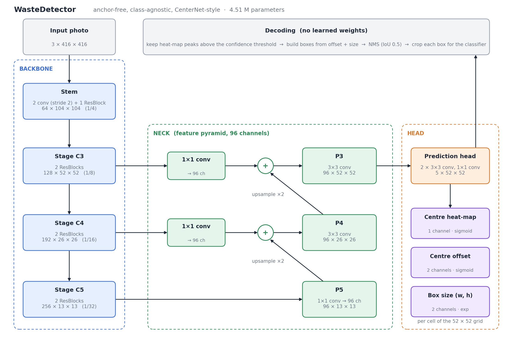
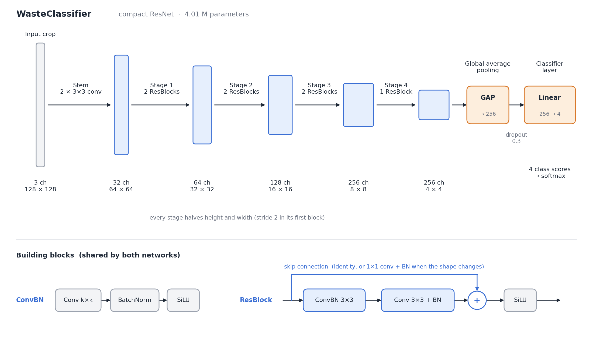
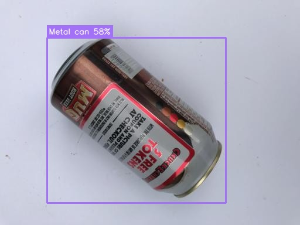

# Waste Sorter

Take a photo of mixed waste. The program draws a box around every item and sorts each one
into a bin: **glass bottle**, **paper cup**, **plastic bottle** or **metal can**.

Everything is a CNN trained **from scratch**. No pretrained weights, no YOLO, no downloaded
models: the networks are defined layer by layer in `wastesort/models.py` and start from random numbers.

## How it works

```
photo ──> [1] DETECTOR CNN ──> boxes ──> crop each box ──> [2] CLASSIFIER CNN ──> label per box
          "where are the items?"                            "what is this item?"
```

|        | Detector                                                                                                                                                     | Classifier                                                                            |
| ------ | ------------------------------------------------------------------------------------------------------------------------------------------------------------ | ------------------------------------------------------------------------------------- |
| Job    | find items, draw boxes (does not care what they are)                                                                                                         | name one cropped item                                                                 |
| Design | CenterNet-style, anchor-free: ResNet-like backbone + small feature pyramid; for every cell of a 52x52 grid it predicts "is an item centred here?" + box size | small ResNet: 5 stages of residual blocks, global average pooling, dropout, 4 outputs |
| Input  | 416x416 photo                                                                                                                                                | 128x128 crop                                                                          |
| Size   | 4.5 million weights                                                                                                                                          | 4.0 million weights                                                                   |
| Loss   | focal loss (heat-map) + GIoU (box) + L1 (centre offset)                                                                                                      | cross-entropy with label smoothing and class weights                                  |

Why two networks instead of one? The classifier can learn from the many photos that only
have a label (no box), which is where almost all paper-cup photos come from. It also gives
you two clean numbers for a report: "how many items did we find" and "how many did we name correctly".

## Architecture

Both networks are built from the same two blocks, defined in `wastesort/models.py`:

- **ConvBN**: convolution, batch normalisation, SiLU activation.
- **ResBlock**: two 3x3 convolutions with a skip connection (identity, or a 1x1 convolution when the
  resolution or channel count changes), as in ResNet.

Convolutions are initialised with Kaiming-normal weights. Those followed by batch norm carry no bias of their own.
All downsampling is done by stride-2 convolutions; there are no pooling layers in either backbone.

### Detector (`WasteDetector`, 4,514,501 parameters)



A single-shot, anchor-free detector in the style of CenterNet. It is class-agnostic: it outputs
"an item is here" and leaves naming to the classifier.

| Part                  | Layers                                                                       | Output (C x H x W) | Scale | Parameters |
| --------------------- | ---------------------------------------------------------------------------- | ------------------ | ----- | ---------- |
| Input                 | RGB photo, letterboxed                                                       | 3 x 416 x 416      | 1     |            |
| Stem                  | ConvBN 3x3 stride 2, ConvBN 3x3 stride 2, 1 ResBlock                         | 64 x 104 x 104     | 1/4   | 93 K       |
| Stage C3              | 2 ResBlocks, first with stride 2                                             | 128 x 52 x 52      | 1/8   | 526 K      |
| Stage C4              | 2 ResBlocks, first with stride 2                                             | 192 x 26 x 26      | 1/16  | 1.24 M     |
| Stage C5              | 2 ResBlocks, first with stride 2                                             | 256 x 13 x 13      | 1/32  | 2.26 M     |
| Neck (feature pyramid) | 1x1 lateral convolutions to 96 channels; top-down nearest-neighbour upsampling and addition; 3x3 smoothing convolutions | 96 x 52 x 52 | 1/8 | 222 K |
| Head                  | ConvBN 3x3, ConvBN 3x3, 1x1 convolution                                      | 5 x 52 x 52        | 1/8   | 167 K      |

The backbone trades resolution for meaning: C3 is sharp but sees only a small neighbourhood, C5 sees
the whole item but is coarse. The neck carries the coarse, high-level maps back up to 1/8 scale and adds
them to the fine ones, so the single output map has both precise localisation and enough context for large items.

For each of the 52 x 52 = 2,704 grid cells the head predicts five values:

| Channels | Meaning                                         | Activation | Loss                                   |
| -------- | ----------------------------------------------- | ---------- | -------------------------------------- |
| 0        | probability that an item's centre is in the cell | sigmoid    | penalty-reduced focal loss             |
| 1-2      | position of the centre inside the cell (0 to 1) | sigmoid    | L1                                     |
| 3-4      | log of box width and height, in cells           | exp        | GIoU on the decoded box (weight 2.0)   |

The box and offset losses are applied only at cells that contain a true centre. The heat-map bias is
initialised to -2.19 (a prior of about 0.1), so training starts from "no item anywhere" and the many
empty cells do not swamp the first updates.

Decoding has no learned parts: keep cells that are a 3x3 local maximum of the heat-map and above the
confidence threshold (0.53, the value with the best F1 on validation data), build each box from its
offset and size, then apply non-maximum suppression at IoU 0.5.

### Classifier (`WasteClassifier`, 4,014,948 parameters)



A compact ResNet with 20 convolution layers and one fully connected layer.

| Part    | Layers                                  | Output (C x H x W) | Parameters |
| ------- | --------------------------------------- | ------------------ | ---------- |
| Input   | RGB crop of one detected item           | 3 x 128 x 128      |            |
| Stem    | ConvBN 3x3 stride 2, ConvBN 3x3         | 32 x 64 x 64       | 10 K       |
| Stage 1 | 2 ResBlocks, first with stride 2        | 64 x 32 x 32       | 132 K      |
| Stage 2 | 2 ResBlocks, first with stride 2        | 128 x 16 x 16      | 526 K      |
| Stage 3 | 2 ResBlocks, first with stride 2        | 256 x 8 x 8        | 2.10 M     |
| Stage 4 | 1 ResBlock, stride 2                    | 256 x 4 x 4        | 1.25 M     |
| Head    | global average pooling, dropout 0.3, linear 256 -> 4 | 4 class scores | 1 K   |

Each stage halves the resolution and (up to 256) doubles the channel count, so the network ends with a
256-number description of the crop. Global average pooling replaces the large fully connected layers of
older designs, which is why the head costs about a thousand parameters. A softmax over the four scores
gives the class probabilities; the largest is the label and its value is the confidence shown on the box.

The diagrams are generated by `tools/make_architecture_figures.py`.

## Try it in your browser

**Live demo: https://nikhil-singh2745.github.io/waste-segregation/**

Nothing to install. The page downloads the two trained networks (33 MB, once) and runs them
on your own device with [ONNX Runtime Web](https://onnxruntime.ai/docs/tutorials/web/), so there is
no server and your photo is never uploaded. It is the same pipeline as the Python code:
`docs/pipeline.js` is a line-by-line port of `wastesort/infer.py`, and it gives the same boxes and labels.

## Run it on your own machine

The trained weights ship in `weights/`, so this works straight after cloning:

```bash
pip install -r requirements.txt
```

```bash
python predict.py my_photo.jpg
```

This prints the count per bin and saves `my_photo_sorted.jpg` with the boxes drawn on it.
Add `--conf 0.4` to change how sure the detector must be before it draws a box.

To open the browser demo locally instead of on GitHub Pages:

```bash
python -m http.server -d docs
```

Then open http://127.0.0.1:8000.

## Data

`wastesort/prepare_data.py` downloads these public Kaggle datasets and merges them:

| Dataset                                                                                                                         | What we take from it                                                      | Licence      |
| ------------------------------------------------------------------------------------------------------------------------------- | ------------------------------------------------------------------------- | ------------ |
| [Drinking Waste Classification](https://www.kaggle.com/datasets/arkadiyhacks/drinking-waste-classification)                     | 4,800 phone photos of cans, glass bottles, plastic bottles **with boxes** | CC0          |
| [VN Trash Classification](https://www.kaggle.com/datasets/mrgetshjtdone/vn-trash-classification)                                | paper cups, cans, PET bottles (label only)                                | MIT          |
| [Recyclable and Household Waste](https://www.kaggle.com/datasets/alistairking/recyclable-and-household-waste-classification)    | glass beverage bottles (label only)                                       | MIT          |
| [Plastic and Paper Cups Synthetic](https://www.kaggle.com/datasets/vencerlanz09/plastic-and-paper-cups-synthetic-image-dataset) | 3,000 computer-generated cup scenes **with boxes**                        | CC BY-SA 4.0 |
| [TACO (YOLO format)](https://www.kaggle.com/datasets/vencerlanz09/taco-dataset-yolo-format)                                     | ~600 outdoor litter photos with bottles/cans/cups **with boxes**          | CC BY 4.0    |

Because nearly all source photos show a single item, training builds artificial "piles":
four photos are tiled into one (mosaic) and extra items are cut from other photos and blended in.

Photos are split into train / validation / test (about 80 / 10 / 10). The drinking-waste photos were
shot in bursts, so they are split in blocks of consecutive photos to keep near-identical shots out of the test set.
The real photos that contain several different items are all kept for testing.

After merging there are 6,782 / 892 / 733 photos (train / validation / test) for the detector and
8,082 / 1,029 / 1,097 single-item crops for the classifier.

## Results

These numbers come from the full training run (60 epochs for the classifier, 80 for the detector,
about 2.5 hours in total on a free Kaggle Tesla T4 GPU). All numbers are measured on test photos
never used for training.

| Full run                                            | Result                                        |
| --------------------------------------------------- | --------------------------------------------- |
| Classifier accuracy (test crops)                    | **89.2%** (89.6% with test-time augmentation) |
| Detector AP@0.5 / precision / recall                | 0.97 / 0.97 / 0.94                            |
| Classifier accuracy on the items the detector found | 92.6%                                         |
| **End-to-end: item found AND named correctly**      | **90.7%**                                     |

| Class          | Items | End-to-end success |
| -------------- | ----- | ------------------ |
| Plastic bottle | 250   | 98.0%              |
| Glass bottle   | 224   | 95.5%              |
| Paper cup      | 81    | 92.6%              |
| Metal can      | 188   | 74.5%              |



What the results show honestly:

- Boxes on real multi-item photos are very good: the detector finds 94% of items.
- **Metal can is the weak class.** It is mostly confused with plastic bottles (blue/white cans look like bottles).
- Paper cup looks strong, but its test items are mostly computer-generated scenes, and no free dataset has real
  photos of used paper cups on a floor. Expect lower accuracy on your own cup photos; adding them
  (see "Retrain" below) helps.

The full numbers are in `runs/classifier/results.json`, `runs/detector/results.json`
and `runs/pipeline/report.txt`, with plots next to them.

## Files

```
predict.py                  command-line demo
notebooks/original.ipynb        the training notebook (upload to Kaggle or Colab, press Run All)
notebooks/after_training.ipynb  the same notebook after the full run, with all outputs
wastesort/config.py         class names, image sizes, dataset list
wastesort/models.py         the two CNNs
wastesort/data.py           loading + augmentation (mosaic, paste, flips, colour)
wastesort/prepare_data.py   downloads and merges the datasets
wastesort/train_classifier.py / train_detector.py   training loops
wastesort/evaluate.py       tests detector + classifier together
wastesort/infer.py          the pipeline used by the demos
tools/build_notebook.py     packs the source files into one self-contained notebook (notebooks/train_on_kaggle.ipynb)
tools/export_onnx.py        converts weights/*.pt to ONNX for the browser demo
tools/make_architecture_figures.py   draws the two architecture diagrams in this README
docs/                       the browser demo (GitHub Pages serves this folder)
docs/pipeline.js            the pipeline in JavaScript (port of wastesort/infer.py)
docs/models/                the two networks as ONNX files
weights/                    the trained models (PyTorch)
runs/                       training curves, confusion matrix, test report, example outputs
my_photos/                  optional: your own photos to add to training
```

## Retrain

The easiest way is `notebooks/original.ipynb` on Kaggle with a GPU. On your own machine (a GPU is strongly recommended):

```bash
python -m wastesort.prepare_data
```

```bash
python -m wastesort.train_classifier --epochs 60
```

```bash
python -m wastesort.train_detector --epochs 80
```

```bash
python -m wastesort.evaluate
```

To teach the classifier with your own photos, put them in `my_photos/<class>/` (one item per photo)
before running `prepare_data`. They are added to the classifier's training set.

After retraining, refresh the models used by the browser demo:

```bash
pip install onnx onnxruntime
```

```bash
python tools/export_onnx.py
```
